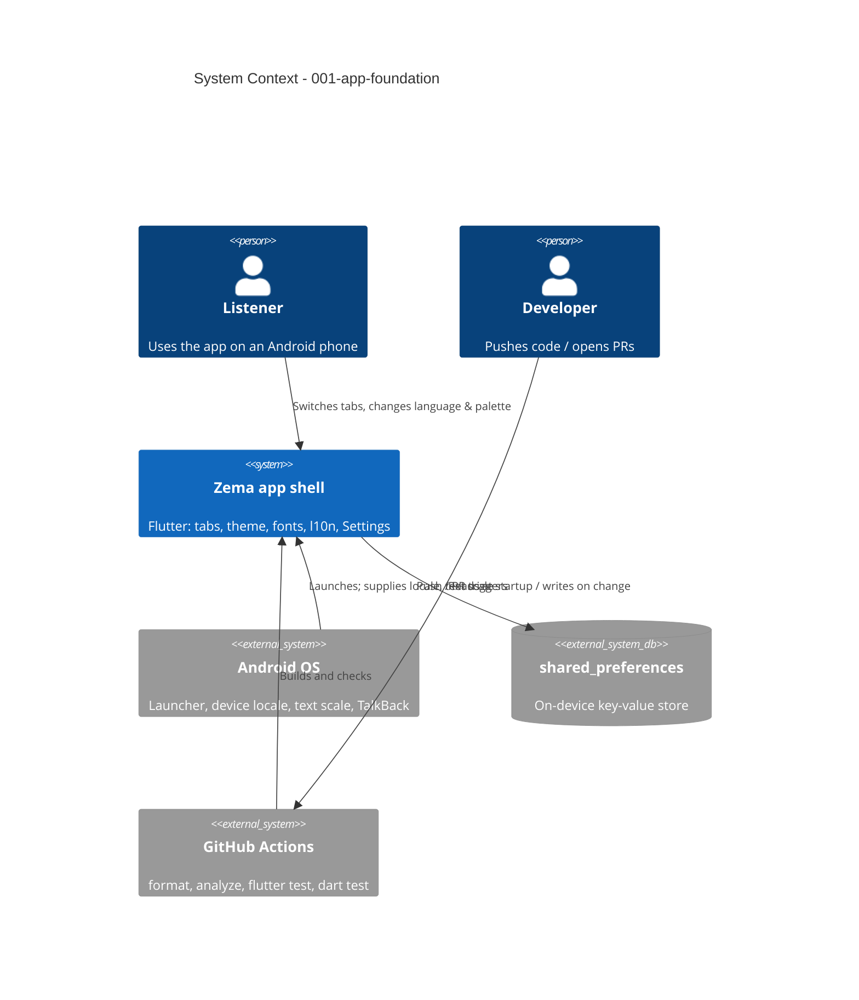

# App Foundation - System Context

## System Overview

The Zema Flutter app shell (`apps/mobile`): four-tab navigation, design-token theme with
two dark palettes, bundled Latin + Ethiopic fonts, localization in four languages, and a
minimal Settings screen. Fully offline. No backend, no native code, no audio. The only
external system is CI (GitHub Actions), which builds and checks the repo.

## Actors

- **Listener** (Human): opens the app, switches tabs, changes language and palette in
  Settings. May read mainly Ethiopic script and use TalkBack or a large font scale.
- **Developer** (Human): pushes code and opens pull requests that CI checks.
- **Android OS** (System): launches the app with its label/icon, provides device locale,
  text scale and accessibility services, persists app preferences on disk.

## Context Diagram

## External Integrations

- **Android OS**: app label/icon, application ID `com.zemaapp.zema`; device locale read once on first launch; system text scale and TalkBack honored.
- **shared_preferences**: local persistence of `localeCode` and `paletteId` (platform plugin, on-device only).
- **GitHub Actions**: CI workflow on push and pull request.

## Data Flows

### Inbound
- **Device locale** (OS → app): used only when no saved language exists; mapped to `en`/`am`/`om`/`ti`, anything else → `en`.
- **Saved settings** (prefs → app): `localeCode`, `paletteId` read before the first frame. Unknown/corrupt values are ignored and defaults used.

### Outbound
- **Settings writes** (app → prefs): on each language/palette change.
- **Network**: none.

## High-Level Constraints

- No network access, no backend, no Kotlin code in this intent.
- Settings stored with `shared_preferences`, loaded before `runApp` so the first frame uses the saved palette and language.
- All colors come from `ZemaColors`; all user-visible strings from ARB files.

## Key NFR Goals

- Cold start < 2 s (release build, mid-range phone).
- Palette/language switch applies immediately with no restart or flicker.
- Touch targets ≥ 44×44, contrast ≥ 4.5:1, TalkBack labels, no overflow at 1.3× text scale or with +40% string length.
