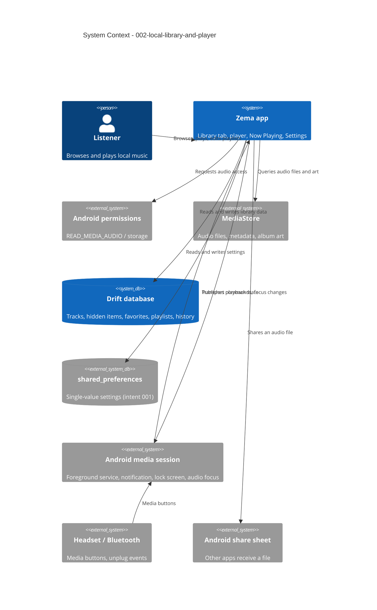

# Local Library and Player - System Context

## System Overview

The Library tab, player and Now Playing screen inside the existing Zema app shell
(`apps/mobile`, intent 001). Zema reads the phone's audio files through Android
MediaStore, keeps its own library data in a Drift database, and plays files in the
background through an Android media session. Fully offline. No backend. Android only;
on iOS the Library tab shows a "not available on iOS yet" state.

## Actors

- **Listener** (Human): grants audio access, browses the library, builds playlists and
  favorites, plays music with the screen on or off. May read mainly Ethiopic script and
  use TalkBack or a large font scale.
- **Android OS** (System): grants or denies `READ_MEDIA_AUDIO`; provides MediaStore;
  hosts the foreground media service, notification, lock screen and audio focus; may kill
  the app under battery saving.
- **Headset / Bluetooth device** (System): sends media button events; unplugging or
  disconnecting triggers "becoming noisy".
- **Other apps** (System): take audio focus (calls, navigation, other players); receive
  shared audio files.

## Context Diagram

## External Integrations

- **Android permissions** (`permission_handler`): `READ_MEDIA_AUDIO` on Android 13+,
  `READ_EXTERNAL_STORAGE` on 12 and older; status, request, open app settings.
- **MediaStore** (behind `LibraryScanner`): `on_audio_query` if the bolt 004 spike
  passes, otherwise a Kotlin `MethodChannel` (`com.zemaapp.zema/library`). Returns ID,
  content URI, path, title, artist, album, track number, year, duration, size, date
  added; album art loaded on demand by ID.
- **Android media session** (`audio_service` + `just_audio` + `audio_session`):
  foreground service, media notification, lock screen, media buttons, audio focus,
  becoming-noisy.
- **Android share sheet** (`share_plus`): shares a track's file (Could).
- **Drift** (SQLite, on device): the app's first database, schema version 1.
- **shared_preferences** (existing `SettingsRepository`): new single-value settings.

## Data Flows

### Inbound
- **Scan results** (MediaStore → app): a list of audio entries, read in full on each
  scan and reconciled with Drift by path, then fingerprint (size + duration + title).
  Entries without a readable path or duration are skipped and counted in the log.
- **Album art** (MediaStore → app): image bytes per album or track, loaded lazily and
  cached in memory; missing art shows a placeholder.
- **Permission status** (OS → app): read on Library open and on app resume.
- **Transport commands** (media session → app): play, pause, next, previous, seek, stop
  from the notification, lock screen and headset.
- **Audio focus and noisy events** (OS → app): pause or lower volume per setting; pause
  on unplug when enabled.

### Outbound
- **Library writes** (app → Drift): reconciled tracks, hidden folders and songs,
  favorites, playlists and their order, play events.
- **Playback state** (app → media session): current item (title, artist, album, art,
  duration), position, playing/paused, available controls.
- **Settings writes** (app → shared_preferences): minimum duration, sort choices,
  playback options, last queue and position.
- **Shared file** (app → share sheet): the content URI of one track.
- **Audio files**: never modified. **Network**: none.

## High-Level Constraints

- Android only; iOS compiles and shows a C07 "not available on iOS yet" state in Library.
- The Drift schema starts at version 1 with a migration test harness.
- Zema IDs are independent of MediaStore IDs (see requirements FR-3).
- Player state is exposed through Riverpod providers for later intents (003, 007).
- Release builds never log full file paths or media metadata above `FINE`.

## Key NFR Goals

- 1,000-track scan < 5 s; stored library on screen < 1 s after launch.
- 60 fps scrolling on 1,000-track lists; tap → audio < 1 s.
- ≥ 30 min background playback with the screen off.
- Favorites, playlists and history: 100% retained across restart and rescan.
