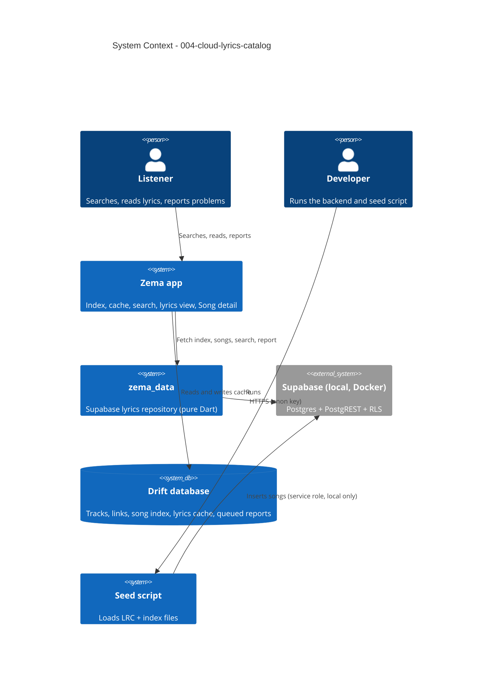

# Cloud Lyrics Catalog - System Context

## System Overview

The Zema app (`apps/mobile`, intents 001–003) gains its first backend: a Supabase
project in `backend/supabase/` holding the shared lyrics catalog. Listeners read it
anonymously; the app keeps a light index of every approved song and a cache of the songs
it has opened, so lyrics keep working offline. A new pure-Dart package,
`packages/zema_data`, is the only code that talks to Supabase. `zema_core` stays free
of backend code but is the single source of the search rules, which are generated into
SQL for the server.

## Actors

- **Listener** (Human, anonymous): searches the catalog, reads lyrics, reports wrong
  lyrics. Often on slow or no connection.
- **Developer / seeder** (Human): runs the local backend and the seed script that loads
  songs from files.
- **Moderator** (Human, future 005/006): reads reports and reviews contributions; the
  schema and roles exist now, the tools come later.

## Context Diagram

## External Integrations

- **Supabase** (Postgres 15+, PostgREST, RLS): tables, RPC functions for search and
  reports, pgTAP tests. Local via the Supabase CLI (`supabase start`, `db reset`).
  The app gets URL + anon key through `--dart-define`; the emulator uses `10.0.2.2`.
- **Drift** (schema v3): song index, cached songs/recordings/timings, queued reports.
- **Network state**: requests fail fast offline; the app falls back to the index and
  cache.

## Data Flows

### Inbound (backend → app)
- **Song index**: every approved song's ID, title, transliteration, artist, album,
  synced flag, version and approval time. Refreshed on start (≤ every 6 h) and on
  pull-to-refresh.
- **Song detail**: sections, play order, recordings and timings for one song, fetched
  when opened or linked, cached with its version.
- **Search results**: lyric-line matches for a query (online only).

### Outbound (app → backend)
- **Reports**: song, recording, reason, note, install ID through a rate-limited RPC;
  queued in Drift while offline.

### Developer
- **Seed**: files in `backend/seed/` (index + LRC) → seed script → tables.

## High-Level Constraints

- All permissions enforced by RLS on the server, proven by pgTAP tests.
- Only the anon key in the app; no service key in the app or repo.
- Search rules generated from `zema_core` tables into SQL (no hand-copied rules).
- Song IDs are stable slugs, so links made in 003 keep working.
- Lyrics text is never logged above `FINE`.

## Key NFR Goals

- Cloud search < 1 s on a 3G-class network.
- Local search < 100 ms per keystroke with 5,000 indexed songs.
- Song index < 500 KB compressed for 5,000 songs.
- 100% of previously viewed songs available offline.
