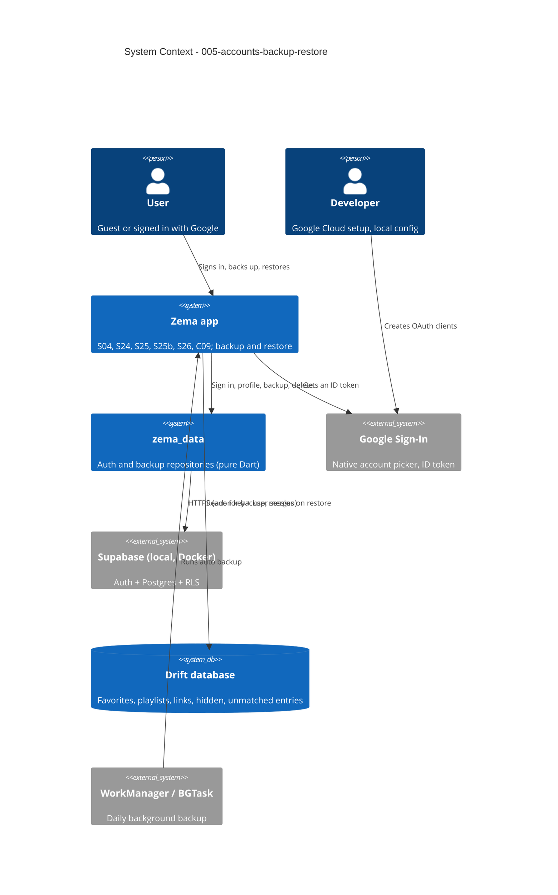

# Accounts, Backup and Restore - System Context

## System Overview

The Zema app gets optional accounts. A user can sign in with Google through Supabase
Auth, which gives them a server identity: a profile and a role in `user_roles`.
Intents 006, 008, 009 and 012 build on that identity.

On top of it, the app backs up the user's library data and settings to a private
server row, as one versioned JSON document, and restores it on another phone. On the
new phone, tracks are matched again by their metadata, because the phone's own track
IDs and paths differ.

Guest mode stays the default, and nothing that works today needs an account.

## Actors

- **Guest** (Human): uses the app with no account. Sees S04 once, and is offered
  sign-in only from Profile, C09 and the restore prompt.
- **Signed-in user** (Human): backs up, restores, edits their name, signs out and
  deletes the account.
- **Developer** (Human): sets up the Google Cloud OAuth clients and puts the client IDs
  in the local config.

## Context Diagram

## External Integrations

- **Google Sign-In** (`google_sign_in`): native account picker on Android and iOS. It
  gives an ID token, which goes to `signInWithIdToken`.
  - Needs OAuth clients: Android (package + SHA-1), iOS, and a web client that
    Supabase checks tokens against.
  - Not set up yet. Until it is, tests use a fake auth repository.
- **Supabase Auth**: the Google provider is set in `config.toml` from environment
  variables, never committed. The session is stored in secure storage (Keychain /
  Keystore).
- **Supabase Postgres**: `profiles`, `backups`, the existing `user_roles`, a trigger
  that makes a profile on sign-up, and a `delete_account` function, all tested with
  pgTAP.
- **WorkManager** (Android), plus background fetch and a check on app open (iOS): the
  daily auto backup on Wi-Fi.
- **Drift** (schema v7): adds unmatched backup entries. The other data already exists.

## Data Flows

### Outbound (app → backend)

- **Sign-in**: Google ID token → Supabase session.
- **Profile**: display name changes.
- **Backup**: one JSON document, under 2 MB, holding:
  - favorites and playlists, each track stored by its identity (title, artist, album,
    duration, file name)
  - lyrics choices made by hand
  - hidden folders and songs
  - settings
  - entries that weren't matched
- **Delete account**: removes the profile, the backup and the auth user.

### Inbound (backend → app)

- **Profile and roles**: name, avatar, role badge.
- **Backup**: the document and its date, for the S26 summary and for restore.

### Local

- **Restore**: document → re-link tracks → merge into Drift in one transaction →
  settings applied. Unmatched entries are kept, and tried again after rescans.

## High-Level Constraints

- RLS on every new table, proven by pgTAP. Users reach only their own rows, and roles
  are changed only on the server.
- Only the anon key and the Google client IDs in the app, both from the gitignored local
  config. No service key in the app or the repo.
- No audio or play history is uploaded.
- Reports (004) stay anonymous.
- Builds without a backend or Google client IDs hide sign-in, and everything else works.

## Key NFR Goals

- Backup of 1,000 favorites + 50 playlists × 100 songs is under 1 MB.
- Re-linking 2,000 entries against 5,000 tracks takes under 2 s, with at least 95%
  matched for the same files.
- Android auto backup runs at least once per 24 h on Wi-Fi.
- Restore is all or nothing.
