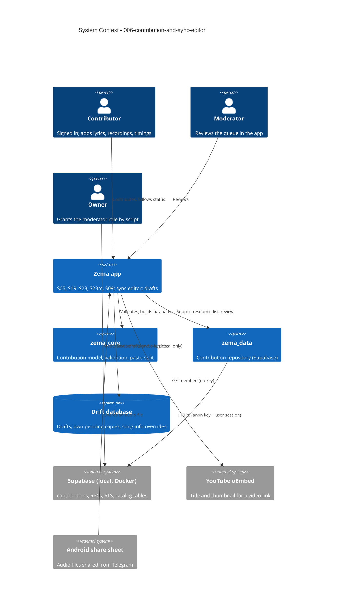

# Contribution and Sync Editor - System Context

## System Overview

Signed-in users (005) contribute to the lyrics catalog (004):

- new songs with their lyrics
- corrections to approved songs
- recordings
- line timings

Each submission is one row in the existing `contributions` table, written only through
server functions that check the shared rules. Moderators review the rows in the app.
Approving one publishes it into the catalog tables in the same transaction. The song's
version goes up, so every phone downloads it as it does any catalog song.

Work in progress lives in the app's Drift database as drafts. The contributor's own
pending lyrics show on their phone right away; nobody else sees them before approval.

## Actors

- **Contributor** (Human, signed in): writes lyrics, links recordings, taps timings,
  submits, follows status, fixes "needs changes".
- **Moderator** (Human, signed in with the `moderator` role): reviews the queue in the
  app, approves, requests changes or rejects.
- **Guest** (Human): sees what contributing is and is asked to sign in (C09).
- **Owner** (Human): grants and removes the moderator role with a server-side script.
- **Listener on another phone** (Human): gets approved content through 004's catalog.

## Context Diagram

## External Integrations

- **Supabase Postgres**:
  - **Already there from 004**: `contributions`, `user_roles`, the catalog tables, and
    `seed_song`'s document format.
  - **New in 006**:
    - submit, resubmit and review RPCs, plus the read policies
    - a `recording` contribution kind
    - source reference columns on `recordings` (YouTube video ID, file name)
    - limits
    - publishing on approval
    - all covered by pgTAP tests
- **YouTube oEmbed** (`https://www.youtube.com/oembed?url=…&format=json`):
  - Gives the title, author and thumbnail URL. No duration, no key.
  - Called from the app with the existing `http` package.
  - A failure doesn't block the step: the video ID is kept and the title can be typed.
- **Android share intent**: an `ACTION_SEND` filter for `audio/*`. Zema copies the
  shared file into app storage. Candidate package: `receive_sharing_intent` or
  `share_handler`, chosen in the bolt.
- **just_audio** (existing): a second, separate player instance for the sync editor.
- **Drift**: new tables for drafts, own pending copies and song info overrides, as
  schema v8 and later.

## Data Flows

### Outbound (app → backend)

- **Submit**: `{ kind, songId?, baseVersion?, payload }`.
  - The payload is a song document in 004's format, or part of one: the song, with a
    recording and its timings for the kinds that have them.
  - The recording's source reference is the YouTube video ID, or the file name for a
    local or Telegram file. Audio is never sent.
- **Resubmit**: the same shape, for the user's own "changes requested" contribution.
- **Review** (moderators): the contribution ID, the decision, and the comment or reason.

### Inbound (backend → app)

- **My contributions**: the user's rows, with status, comment, dates and reviewer
  decision time. The badge compares them with the last check.
- **Queue** (moderators): pending rows, oldest first, plus the current song document
  for diffs.
- **Approved content**: through 004's catalog index and `get_song`, unchanged.

### Local

- Drafts are saved after every change (S19–S22) and on every sync tap.
- Own pending copy: the submitted document is kept for the linked track until the
  status changes.
- S09 overrides are applied over the file's tags wherever tracks are shown, searched or
  matched.

## High-Level Constraints

- Nothing contributed is publicly readable before approval. 004's read rules
  (approved songs only) stay as they are.
- Only the anon key in the app. The moderator script uses the service key locally and
  never commits it.
- No audio uploads, no in-app video, no push notifications.
- Builds without a backend hide the Contribute actions.

## Key NFR Goals

- Tap timings within ±0.3 s after nudging; a tap is recorded within 50 ms of the audio
  position.
- No draft lost when the app is killed (saved within 1 s).
- Approval publishes all or nothing; racing reviews leave one result.
- Limits: 20 pending per user, 30 submissions a day, 256 KB per contribution.
